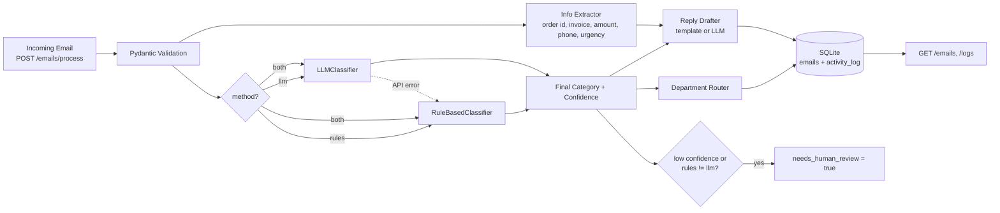

# Architecture

## Components

| Module | Responsibility |
|---|---|
| `app/schemas.py` | Pydantic models and the category -> department table |
| `app/classifiers/` | `BaseClassifier` (abstract) with `RuleBasedClassifier` and `LLMClassifier` |
| `app/extractor.py` | Regex based extraction of key fields |
| `app/drafter.py` | Reply drafts (templates; LLM when available) |
| `app/service.py` | `EmailProcessor` orchestrates the pipeline |
| `app/database.py` | SQLite persistence and activity log |
| `app/main.py` | FastAPI app factory and routes |

## Design decisions
- **Strategy pattern**: classifiers share one interface, so new ones (e.g. a fine-tuned model) plug in easily.
- **Dependency injection**: the LLM call is a plain function, so tests run offline with a fake.
- **Graceful degradation**: if the LLM fails, the pipeline falls back to rules and logs the error.
- **Human in the loop**: low confidence or rules/LLM disagreement sets `needs_human_review`.
